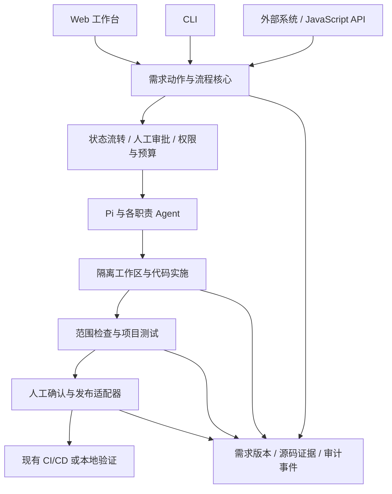
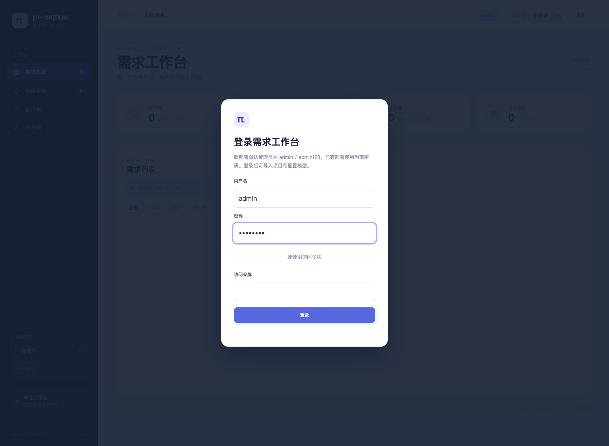
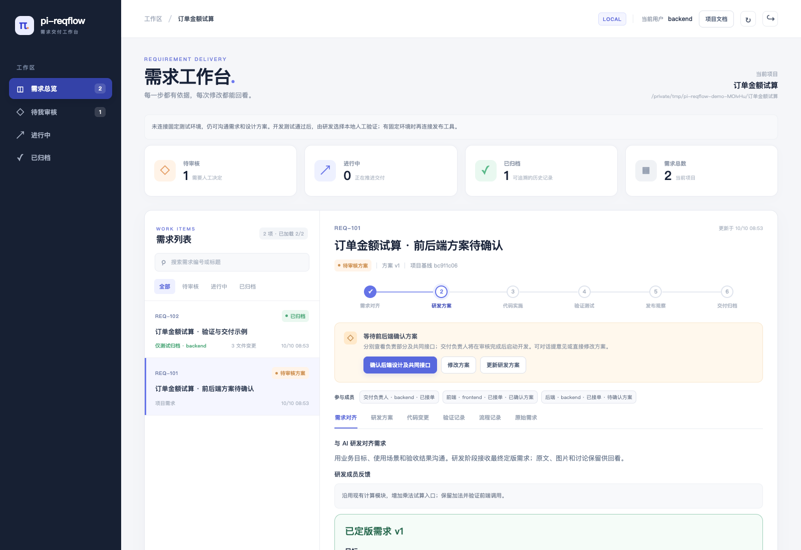
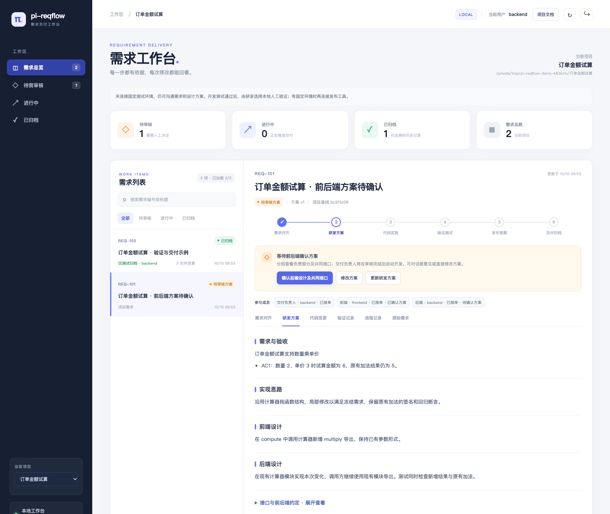
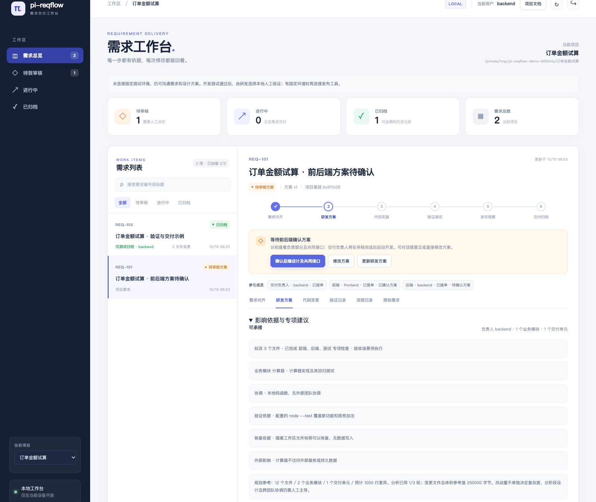
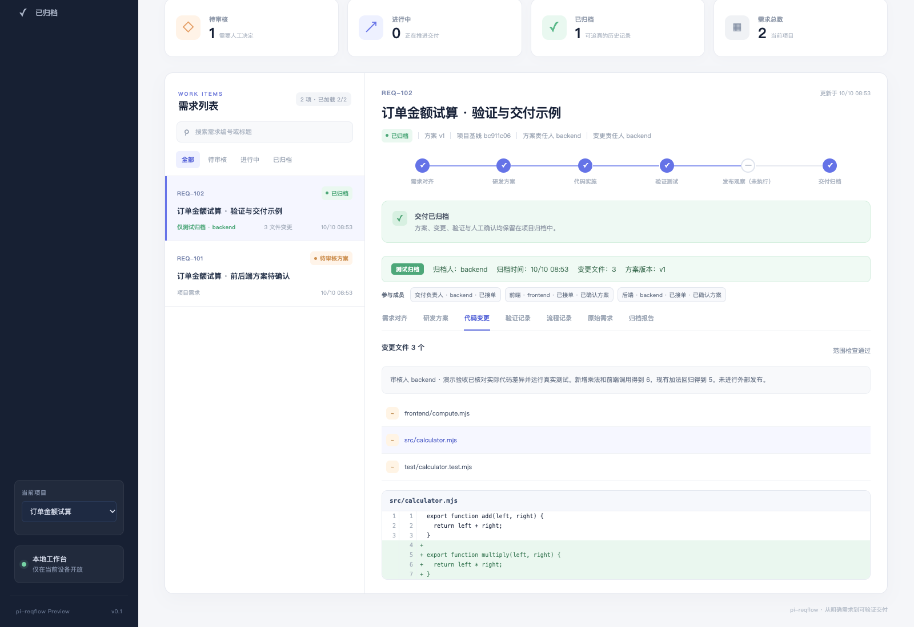
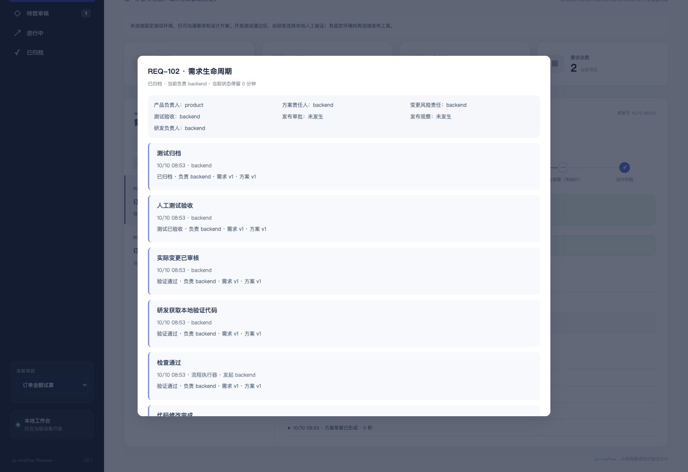
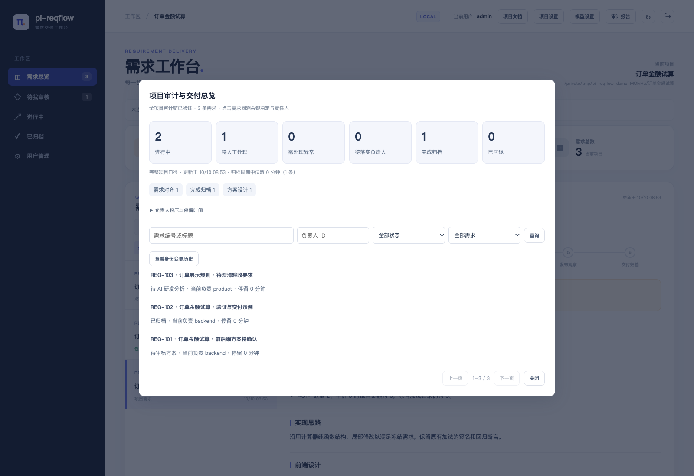

# pi-reqflow

**面向已有系统二次开发的多 Agent AI Coding 工作台，让需求从沟通到交付可控、可回溯。**

[](LICENSE) · [Docker 部署](docs/docker.md) · [模型配置](docs/agent-models.md) · [接入现有系统](docs/integration.md)

已有系统里的一个“小需求”，往往同时牵涉业务规则、前后端约定、历史行为和发布流程。开发者需要知道 AI 理解了什么、准备改哪里、哪些旧功能可能受影响，以及交付的代码是否还是自己批准的那一版。

pi-reqflow 基于 [Pi](https://github.com/earendil-works/pi) 组织多 Agent 协作，把项目理解、需求沟通、技术方案、代码实施、自动检查和人工验收放进同一个需求生命周期。产品确认业务目标，研发确认技术方案与实际变更，系统保存每一步的版本、责任人和执行证据。

项目提供 **Web 工作台、CLI 和可嵌入的 JavaScript 核心**，支持 Docker Compose 部署，并能连接现有 CI/CD。它围绕真实代码库开展工作，适合增加筛选、调整业务规则、扩展接口、完善前后端功能等边界明确的存量需求。

[多 Agent 协作](#多-agent-如何协作) · [已有系统二次开发](#围绕已有系统做二次开发) · [需求全生命周期](#需求全生命周期可控可回溯) · [工程实现](#工程实现) · [工作台截图](#工作台截图)

## 为什么用 pi-reqflow

- **多 Agent 分工协作**。七类 Agent 按阶段承担不同职责，前端、后端、QA 根据需求影响参与专项检查，代码实施遵循已确认的方案。
- **从现有代码和业务规则出发**。初始化建立项目理解，后续结合源码位置、接口与数据影响制定增量方案，把旧功能回归写入验证要求。
- **需求与代码交付放在一起管理**。从沟通、接单、需求定版到开发、验证、发布、验收，每个阶段都有明确状态、责任人和可查看的产物。
- **人掌握关键执行权**。审批绑定需求、方案和源码版本；前后端可分别审核分工内容，共同接口变化会使相关审批失效。
- **交付过程留下证据**。隔离工作区保存代码差异、检查日志、模型调用与用量，需求事件通过哈希链关联，可查看生命周期和项目审计报表。
- **接入团队已有工具**。支持本地目录与 Git worktree，提供 Jenkins、GitLab CI/CD、GitHub Actions 和自定义发布适配器，也可将核心 API 嵌入现有门户。

## 多 Agent 如何协作

每类 Agent 有独立的职责和模型配置。流程根据冻结需求、源码证据和影响判断安排调用，各阶段的结构化产物经过校验后进入下一步。

| Agent | 主要职责 | 交付给下一阶段的内容 |
| --- | --- | --- |
| 项目理解 `initialize` | 梳理已有代码、项目结构与检查入口 | 有源码依据的项目说明与导航 |
| 需求沟通 `intake` | 多轮澄清业务目标，可结合图片理解需求 | 当前行为、期望行为、范围与验收标准 |
| 方案设计 `plan` | 只读调研，分析改动位置和影响 | 前后端设计、接口约定、关键逻辑与验证方案 |
| 前端评审 `frontendReview` | 检查前端职责内的需求和设计问题 | 前端专项发现与需要处理的问题 |
| 后端评审 `backendReview` | 检查后端职责内的需求和设计问题 | 后端专项发现与需要处理的问题 |
| 测试评审 `qaReview` | 检查历史行为、接口、数据与验收风险 | 验收覆盖、回归要求与阻塞问题 |
| 代码实施 `implement` | 按批准方案在隔离工作区修改代码 | 实际差异与待检查的代码版本 |

跨前后端的方案会追加前端和后端专项检查；有已知历史行为、接口、数据或外部风险时追加 QA 检查。简单需求减少重复调用，影响未知时先补证据。代码由一个实施 Agent 写入，统一检查，避免多个写入者争抢工作区。

产品、前端研发、后端研发与交付负责人是人工角色。拆分研发分工后，前后端分别确认自己负责的方案内容，交付负责人推进实施。**Agent 的建议不会替代人工批准**。

各 Agent 可以选择不同的 provider/model，单需求共用成本上限。项目记录实际调用的角色、模型、token、成本与执行轨迹，便于核查调用效果和开销。详见 [模型配置](docs/agent-models.md)。

## 围绕已有系统做二次开发

pi-reqflow 的设计重点是理解已有约束，再完成有限范围的增量交付。

- **先理解项目**。初始化建立项目说明和源码导航，结合已有检查命令与代码规范，后续需求从当前系统的实现出发。
- **方案落到文件和行为**。方案列出拟改文件与改法，说明前端、后端、接口和数据影响，并为验收项安排新功能验证与旧功能回归。
- **源码事实可复用**。读取过的代码片段保存文件、行号和内容哈希，后续阶段或需求复用前校验。源码变化会使证据失效，历史讨论与其他 Agent 的结论不会混成源码事实。
- **保持开发环境可检查**。配置限定可读写路径、真实测试命令与环境变量，实施在目录副本或 Git worktree 中进行，研发可审阅实际差异。

例如，在现有计算模块上增加订单金额试算，可以先冻结“数量乘单价”的验收要求，同时保留原有加法行为。方案明确新增函数、调用位置和回归用例，前后端确认参数约定，实施后执行检查，再由研发验证结果。页面截图使用这一独立演示场景。

适合已有业务系统的局部功能迭代、规则调整和前后端配套改动。实施范围、影响或验收方式无法核实时，流程会停止并交回研发处理。架构重建、复杂迁移和跨团队长任务需要研发主导。详见 [实施范围](docs/system-scope.md)。

## 需求全生命周期可控、可回溯

```text
项目理解 → 产品沟通 → 研发接单 → 需求定版
        ↓
Agent 设计方案与验收测试
        ↓
研发确认方案
        ↓
Pi 在隔离工作区开发与测试
        ↓
研发审阅实际变更 → 本地验证或确认测试发布
        ↓
人工验收与归档
```

| 阶段 | 人工控制点 | 可回溯的记录 |
| --- | --- | --- |
| 沟通与定版 | 产品确认目标、范围与验收标准，研发接单 | 沟通记录、需求版本、分工与责任人 |
| 方案设计 | 研发讨论并确认方案，分工方案分别审核 | 源码基线、拟改文件、接口约定、专项发现与审批 |
| 开发与检查 | 按已批准范围实施，检查失败需要处理 | 工作区、代码差异、测试日志、失败原因与修复记录 |
| 验证与发布 | 研发审阅实际变更，选择验证方式并批准发布 | 变更版本、审批依据、CI/CD 执行与部署结果 |
| 验收与归档 | 人工确认交付结果；生产发布单独配置与批准 | 验收结论、归档报告与完整事件时间线 |

**审批跟随具体版本**。需求、方案、源码基线和验证后的文件通过哈希关联。方案或共同接口变化会影响审批有效性，发布前复核实际代码，减少“审核的是一版，执行的是另一版”的风险。

**失败保留现场**。实施、检查和模型调用的成功与失败均留下记录；受控续执行保留此前日志与差异，并重新验证。需求生命周期可以回答谁确认了什么、AI 改了哪些文件、检查为何失败、当前等待谁处理。

**项目层面可管理**。工作台展示活跃需求、等待人工处理、待关注任务和责任分配；审计报表汇总交付状态与模型用量，单个需求可继续查看生命周期和执行诊断。审计事件通过哈希链校验关联，文件回退会检查后续修改。详见 [审计与管理](docs/audit-management.md)。

## 工程实现

核心流程与 Web 页面分开，CLI、Web 和外部系统调用同一组动作接口。需求状态、权限和证据校验在服务端执行，页面展示操作入口与过程产物。



| 设计关注点 | 实现方式 | 源码入口 |
| --- | --- | --- |
| 多 Agent 组织 | 分阶段调用、结构化输出校验、按影响追加专项检查 | [方案分析](src/plan-analysis.js) · [Pi 执行](src/pi-runner.js) |
| 现有系统理解 | 项目初始化、源码导航、带哈希的证据复用 | [项目理解](src/project-initialization.js) · [上下文设计](docs/context-engineering.md) |
| 交付状态与权限 | 明确的动作分发、人工角色授权、版本绑定审批 | [动作入口](src/actions.js) · [认证与授权](src/auth.js) · [方案审批](src/plan-review.js) |
| 隔离与验证 | 目录副本 / Git worktree、范围约束、检查日志与变更证据 | [工作区](src/workspace.js) · [交付流程](src/workflow.js) |
| 可观测与审计 | 模型轨迹与用量、需求事件、哈希链和管理报表 | [审计报表](src/report.js) · [数据存储](src/store.js) |
| 外部系统集成 | 可嵌入的 ESM API、同步 / 异步发布适配器、现有 CI 平台 | [核心 API](src/core.js) · [适配器文档](docs/deployment-adapters.md) |

技术栈采用 Node.js 22、ES Modules 和原生 Web 页面，Pi 承担模型交互与工具执行。项目保留可直接阅读的流程实现，方便检查每个控制点如何生效，也方便替换模型配置或接入已有工单与发布系统。

## 快速启动

### Docker Compose

安装 Docker Engine / Docker Desktop 和 Docker Compose，在源码目录执行一条命令即可启动

```sh
docker compose up -d --build
```

打开 <http://localhost:4173>，使用默认管理员 **`admin` / `admin123`** 登录。首次启动会自动创建内置计算器演示项目，进入工作台后再导入自己的项目、配置模型。

接入自己的已有项目时，只需在启动命令中指定目录

```sh
REQFLOW_PROJECT_DIR=/absolute/path/to/your-project docker compose up -d --build
```

登录后点击左侧“导入”，项目目录已填为 `/projects/project`，填写项目名称即可接入。导入先建立源码索引，不调用模型。源目录以只读方式挂载，实际开发在持久化的导入副本和隔离工作区中进行。

在“模型设置”保存 API 地址、模型和密钥，在“项目设置”核对检查方式，需要发布时再配置发布入口。在“用户管理”添加产品与研发成员，也可重置默认管理员密码。重启沿用已有账号与项目，启动不会重置密码。

镜像已包含 Node.js、Git、ripgrep 和 Pi。Java、Python、Go 等项目可扩展工具链。自定义端口、已有项目的 CLI 部署、持久化备份与升级见 [Docker 部署指南](docs/docker.md)。

### 本机运行

需要 Node.js **22.12+**、Git，以及本项目固定使用的 Pi **0.87.1**。

```sh
npm ci --ignore-scripts
npm install -g @earendil-works/pi-coding-agent@0.87.1
npm start
```

打开 <http://127.0.0.1:4173>，使用 **`admin` / `admin123`** 登录内置演示项目，再从工作台导入目标项目并配置模型。Pi 从 `PATH` 中自动定位；特殊安装位置可通过 `REQFLOW_PI_EXECUTABLE` 指定。

从源码执行 CLI 可直接使用 `node src/cli.js`；本地安装包后命令为 `pi-reqflow`。保留 `reqflow`、`devsail` 命令别名及 `.reqflow` / `REQFLOW_*` 存储与配置约定，已有模型凭据的内部标识也保持兼容。

## 配置与接入

- 模型支持 Pi 内置 provider 与 OpenAI 兼容接口，可按执行角色选择模型并限制 token、调用次数和时间。详情见 [模型配置](docs/agent-models.md)。
- 测试与发布命令由项目显式提供。开始自动开发前必须具备真实检查入口，配置缺失或非法会报错。详情见 [运行策略](docs/policy.md)。
- Git 提交、推送与测试分支合并由负责研发在查看变更后明确授权。详情见 [Git 交付](docs/git-delivery.md)。
- 使用核心 API 接入自己的门户、工单或发布系统。入口为 `src/core.js`，详情见 [集成接口](docs/integration.md) 和 [发布适配器](docs/deployment-adapters.md)。

## 数据与执行边界

目标项目的需求、快照和审计保存在 `.reqflow/`；服务账号、会话和导入项目保存在 `REQFLOW_STATE_DIR` 指定目录。Docker 部署还会保存隔离工作区与 Pi 状态卷，备份时需要一起保存。

模型服务会收到任务所需的源码和需求上下文。容器内的 Pi 与项目检查共享挂载和进程环境，当前容器部署不提供每个需求独立的安全沙箱。文件 `rollback` 仅恢复需求工作区文件，无法撤销远端提交、部署或数据库变更。

当前版本为 **0.1.0 / Preview**。没有内置 OIDC/SSO 或通用生产回滚。远程团队访问需要 TLS 入口。Jenkins、GitLab、GitHub 适配器的自动测试覆盖模拟接口与本地交付流程，接入实际平台后仍需验证首个真实发布。

## 文档

| 主题 | 文档 |
| --- | --- |
| 安装、持久化、升级与镜像发布 | [Docker](docs/docker.md) · [发布指南](docs/releasing.md) |
| 模型与执行规则 | [模型](docs/agent-models.md) · [策略](docs/policy.md) · [代码规范](docs/coding-standards.md) |
| 需求、方案与职责 | [需求沟通](docs/requirement-review.md) · [研发方案](docs/development-design.md) · [承接边界](docs/admission-boundary.md) |
| Git 与测试发布 | [Git 交付](docs/git-delivery.md) · [CI 平台](docs/ci-platforms.md) · [扩展适配器](docs/deployment-adapters.md) |
| 核心 API 与架构 | [集成](docs/integration.md) · [架构](docs/architecture.md) · [上下文](docs/context-engineering.md) |
| 审计、用量与管理 | [审计报表](docs/audit-management.md) |

## 开发与贡献

```sh
npm ci --ignore-scripts
npm run check
npm test
```

常规测试使用模拟 Pi，无需模型密钥。Docker 部署测试需先构建镜像，再显式执行 `REQFLOW_DOCKER_DEPLOYMENT_TEST=1 node --test test/docker-deployment.test.js`，会验证登录、审批权限与重启后的数据持久化。

欢迎提交可复现的问题与聚焦的改动。参与方式见 [CONTRIBUTING.md](CONTRIBUTING.md)。

## 许可证

[MIT](LICENSE)。pi-reqflow 是基于 Pi 构建的独立项目，所依赖的 Pi 与第三方组件遵循各自许可证。

## 工作台截图

以下截图来自真实运行的工作台，使用独立的“订单金额试算”演示项目。模型响应来自测试用模拟 Pi，状态流转、前后端研发审核动作、隔离文件修改和 Node.js 检查均实际执行。截图用于展示产品交互与工程机制，未使用真实业务需求或模型凭据。

### 默认账号登录

首次启动自动准备演示项目和管理员，直接登录后再导入业务项目、配置模型。



### 需求工作台

在同一页面查看需求列表、当前阶段、研发分工和下一步操作。已定版的需求与验收标准随任务保存。



### 研发方案与分工审核

方案连接需求验收、实现思路和前后端设计。示例中前端已确认自己负责的内容，后端仍待确认，代码实施尚未开始。



### 多 Agent 专项检查

查看前端、后端和测试专项检查，以及源码影响、验证和恢复依据。研发可以继续与 AI 讨论方案，再决定是否批准。



### 实际代码变更

审阅隔离工作区中的文件差异，核对实际实现与批准范围。示例涉及计算模块、前端调用和回归测试三个文件。



### 需求生命周期

按时间回看需求定版、方案审核、开发、检查和验收，查看各节点的责任人与版本信息。



### 项目审计与交付总览

管理员查看进行中、待人工处理、待关注和已归档需求，并核查事件完整性与模型用量。



## 联系方式

联系邮箱 460856760@qq.com
